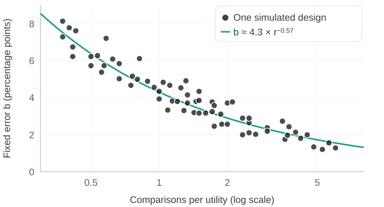
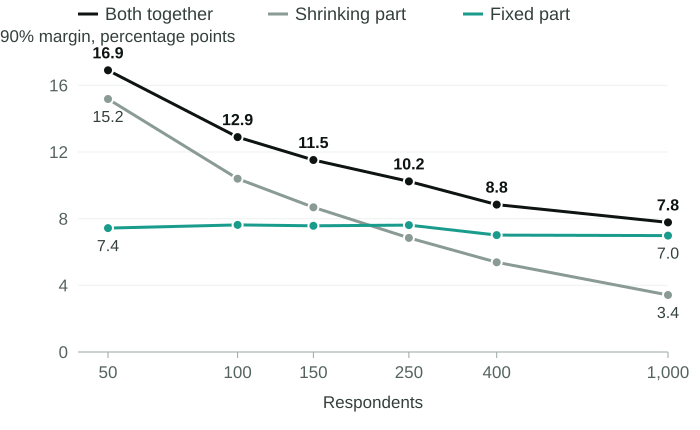
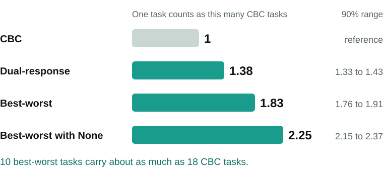
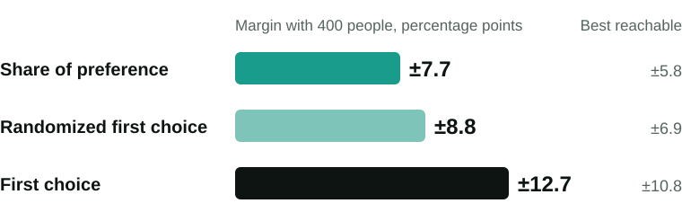
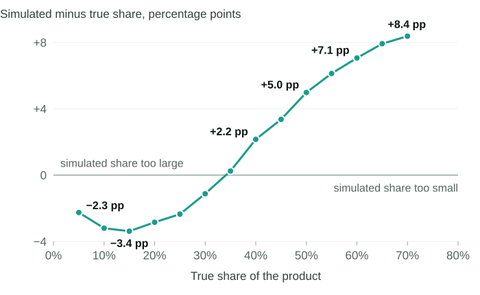
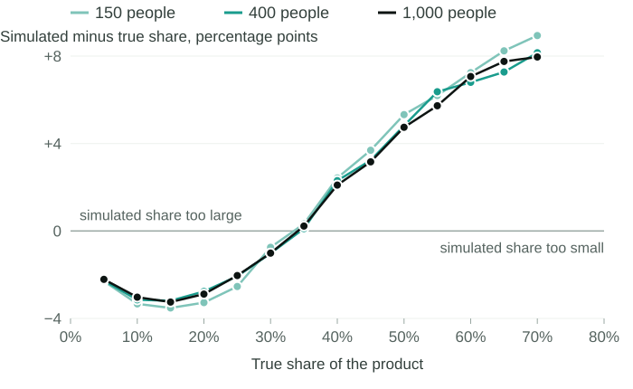
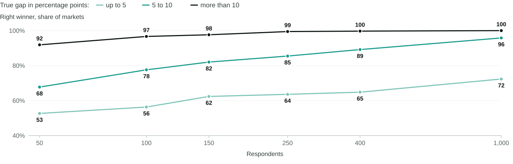

# The whole error of a choice share: findings of the simulation

This text gives the findings of the simulation on the whole error of a choice share in full. The article "Conjoint
analysis sample size calculator" on choicery.ai gives a short version. "The formula" means the formula for the whole
error of a choice share in `README.md`. The run files behind all numbers are in `data/`; `analysis/reproduce.py` rebuilds
the formula and Table 1, and `analysis/scripts/prior_variance_shares.py` the numbers of Finding 6.

The calculator of the article plans the sampling error of a choice share. This part measures the whole error of a share: who takes part, noise in the answers and the estimation. We simulated people whose true utilities are known, let them answer CBC tasks built by Choicery's design generator, estimated their utilities with Choicery's Hierarchical Bayes at its default settings and ran the result through the market simulator. The error of a share is the simulated share minus the true share in the whole simulated population, in markets with three or four products. The formula for the whole error rests on 1,608 estimation runs: 67 designs, each with four populations and samples of 150, 400 and 1,000 people. A further 4,872 runs that were not used for the fit check it: smaller samples of 50, 100 and 250 people, new populations and designs, populations estimated from real studies, and an earlier simulation with more varied people. Another 1,134 runs compare dual-response and best-worst tasks with CBC (Finding 3). The run files of the simulation and a script that rebuilds the formula and Table 1 from them are public on [GitHub](https://github.com/choicery/conjoint-sample-size-simulation).

- **Designs:** 67 behind the formula, with 4 to 8 attributes, 3 to 5 levels, 6 to 16 tasks and 2 to 4 options. 23 more in the test runs, with 3 to 12 attributes and 2 to 6 levels
- **Populations:** 4 per design. Size and spread of the utilities follow the medians of 20 conjoint studies that we re-estimated
- **Respondents:** 50, 100, 150, 250, 400 and 1,000 per run, check runs with 150 to 1,016
- **Estimation runs:** 6,480 with CBC, 1,608 of them behind the formula, and 1,134 with other question formats

## Finding 1: The design sets a limit that more respondents cannot move

**Figure 1.** Fixed part of the error by design. 67 designs, share of preference, markets with three or four products. Each dot averages four simulated populations and samples of 150, 400 and 1,000 people. The curve explains 90% of the variation on the log scale.

**Figure 2.** The 90% margin and its two parts by sample size. Mean over the 67 designs with four populations each, measured against the true share in the population.

In Figure 1, each dot is one design. The horizontal axis shows how much each person tells the model: comparisons per utility, that is tasks × (options − 1), divided by the number of utilities to estimate. The vertical axis is the part of the error that stays, however many people take part. It falls from about 7 percentage points for the thinnest designs to about 1.5 for the richest, and one curve describes it well: b ≈ 4.3 × r^−0.57.

In Figure 2, the black line is the margin that 9 out of 10 simulated shares stayed within. It falls from ±16.9 percentage points with 50 people to ±7.8 with 1,000. The grey line is the part that shrinks with the sample: who happens to take part, and noise in the estimate, which makes up about 77% of it. The green line is the fixed part from Figure 1. From about 250 people on, the fixed part is the larger of the two.

**What follows.** More respondents pay off until the fixed part sets the margin. After that, only the design helps. In the example design (levels 3, 4, 4, 3, 5, with 10 tasks and 3 options), ±7 percentage points take 659 people. With 15 tasks per person, 264 are enough in the simulation, where people answer every task equally well. Real respondents may not: predictive validity often peaks before the last task (Li et al., 2022; Sablotny-Wackershauser et al., 2024). A leaner design, with fewer attributes or levels, is the safer way to lower the limit. The calculator of the article does not contain this limit: its number for the choice share is the sampling error alone.

## Finding 2: The margin holds from 50 to 1,000 respondents, on new designs and on populations from real studies

**9 out of 10 shares stayed inside the margin**

| Simulation runs | Runs | Inside the 90% margin | Inside the 95% margin |
|---|---:|---:|---:|
| **Runs the formula was built from** |  |  |  |
| 150 people | 536 | 89.7% | 94.8% |
| 400 people | 536 | 90.1% | 95.0% |
| 1,000 people | 536 | 90.2% | 94.9% |
| **Test runs the formula has not seen** |  |  |  |
| 50 people | 536 | 90.2% | 94.9% |
| 100 people | 536 | 90.4% | 95.2% |
| 250 people | 536 | 90.1% | 94.5% |
| Example design, 12 new populations | 120 | 93.0% | 96.7% |
| 23 designs outside the 67, 8 populations each | 1,104 | 91.9% | 96.1% |
| Populations estimated from 18 real studies | 432 | 90.8% | 95.3% |
| Earlier simulation with more varied people | 1,608 | 92.8% | 96.6% |

**Table 1.** Share of simulated choice shares that stayed inside the margin of the formula. The numbers in the formula were set with the first three rows only. The rows below were kept out of that step: they test whether the finished formula also holds for sample sizes, designs and populations it has not seen. Share of preference, markets with three or four products. The new populations and designs were run with 150 to 1,016 people, the last two rows with 150, 400 and 1,000.

A formula fitted to simulated data will describe those data. What matters is whether it holds on data it has not seen. Table 1 lists four kinds of such data.

The first two are small samples and other designs. With 50, 100 and 250 people, between 90.1% and 90.4% of the shares stayed inside the 90% margin, although the formula had only seen samples from 150 people up. For the example design with twelve new populations it was 93.0%, and for 23 designs outside the 67 it was 91.9%. These designs have 3 to 12 attributes with 2 to 6 levels each. Taken one by one, they reached between 86% and 95%.

The third kind leaves the generator aside. For 18 conjoint studies we drew the simulated people from the utilities that Hierarchical Bayes had estimated for the study, with the estimated correlations between utilities, which the generator does not have. In these 432 runs, 90.8% of the shares stayed inside the 90% margin. These studies have 3 to 12 attributes with 2 to 6 levels each. In the 12 studies with two-level attributes it was 91%, in the 2 studies with three attributes 94%, and in the 3 studies with more than eight attributes 85%.

The fourth is an earlier version of this simulation, in which people differed about 1.4 times as much as in the 20 studies. Its 1,608 runs were not used for the present formula. There, 92.8% of the shares stayed inside, so the margin is on the safe side when people differ more.

The wider margin for 19 out of 20 shares, with a factor of 2.0 instead of 1.65, held in the same way.

**What follows.** The 90% margin of the formula is a measured frequency: in the simulation, 9 out of 10 shares stayed within it. It needs no minimum sample size of its own. Below 50 people nothing was simulated.

## Finding 3: Question format and simulator method change the whole error

**Figure 3.** Worth of one task relative to a CBC task, measured on choice shares in markets without None. 1,134 runs on 23 designs with 150, 400 and 1,000 people, each compared with the CBC run of the same people and tasks. Best-worst with None: with a buy question after the choice. The 90% range comes from resampling the designs.

**Figure 4.** 90% margin by simulator method. Example design: levels 3, 4, 4, 3, 5, with 10 tasks and 3 options. Measured against the choices the simulated people would really make, over 67 designs and three sample sizes.

Best-worst and dual-response tasks ask more per screen than a plain CBC task. We ran both formats, and best-worst with a buy question after the choice (None), on 23 of the 67 designs and three of the four populations, with the same simulated people, the same tasks and the same markets as the CBC runs: 1,134 further estimation runs. Best-worst needs at least three options per task and ran on 20 of these designs. Measured on the shares in markets without None, one dual-response task was worth 1.38 CBC tasks, one best-worst task 1.83 and one best-worst task with None 2.25 (Figure 3). The three populations gave 1.4, 1.8 to 1.9 and 2.2 to 2.3. Another study found a similar gain for dual response: about 30% more statistical information than with a single answer per task (Hung et al., 2025).

The formula multiplies the number of tasks by the rounded factors 1.4, 1.8 and 2.2. With them, 89.7% of the shares (dual-response), 89.8% (best-worst) and 90.1% (best-worst with None) stayed inside the 90% margin, against 89.9% in the CBC runs with the same people. With 400 people, the root mean square error of a share was 5.1 percentage points with CBC, 4.5 with dual-response, 3.9 with best-worst and 3.5 with best-worst with None.

Formats with a buy question also give the share of people who would buy none of the products. The simulated people declined in about 25% of the tasks. In markets that include None, the None share came out 1.8 to 2.3 percentage points too large on average, and only 84 to 85% of the None shares stayed inside the 90% margin. A None option inside a plain CBC task, chosen in 4 to 28% of the tasks, cost nothing in the earlier simulation with more varied people: 95% of the product shares stayed inside the 90% margin.

How much of this carries over to real respondents is less certain for best-worst than for dual-response. Choice tasks are used because they mimic a purchase decision (Eggers et al., 2022). A best-worst task is further from that: people buy the product they like best and never pick a worst one. The analysis assumes that a worst choice is a reversed best choice, so that both answers measure the same preferences and the estimation has twice as many observations (Eggers et al., 2022). That is close to what we measured, 1.83 CBC tasks for one best-worst task, because our simulated people answer exactly that way, and with the same care for both questions. If real respondents answer the worst question less carefully, one best-worst task is worth less than measured here.

With None, a buy question follows the best and the worst answer, so a ranking and a purchase decision go into one model. In dual-response CBC, both questions are about buying.

Best-worst can still be the better choice. With few reachable people, such as managers or physicians, more respondents are not an option, and more answers per person are the only way to a smaller margin. With 100 people, the example design gives ±11.6 percentage points with CBC and ±9.0 with best-worst. Even a smaller gain than in our simulation helps there.

The simulator method matters as well (Figure 4). Share of preference spreads each person's choice across the products. First choice gives it all to one product, so small errors in individual utilities flip whole choices. In the example design with 400 people, the margin is ±7.7 percentage points with share of preference, ±8.8 with randomized first choice and ±12.7 with first choice.

The limit that more respondents cannot move rises as well, from ±5.8 to ±10.8 percentage points.

**What follows.** For the same precision, a best-worst study needs fewer people or fewer tasks than a CBC study, and a simulation with first choice needs clearly more people than one with share of preference. In the example, ±8 percentage points take 335 people with CBC, 189 with dual-response, 136 with best-worst and 107 with best-worst with None. And ±12 percentage points take 93 people with share of preference and 644 with first choice.

## Finding 4: Large shares come out too large, small ones too small

**Figure 5.** Mean error of a simulated share by the true share of the product. Each dot is the mean over all simulated products whose true share lies within 2.5 percentage points of the value below it. 67 designs, share of preference, 50 to 1,000 people. Products with a true share below 2.5% or above 72.5% are left out (7% of all).

**Figure 6.** The line of Figure 5, drawn separately for 150, 400 and 1,000 people.

Figure 5 sorts all simulated products by their true share. Products with a true share below about 34% came out too small on average, larger ones too large: 3.2 percentage points too small at a true share of 10%, and about 8 too large at 65 and 70%.

The line bends back towards zero at the far left because the error is in percentage points. A product with a true share of 5% cannot lose more than 5 percentage points. Measured against their own size, these smallest products lose the most, about 44% of their share.

Figure 6 draws the same line for three sample sizes. The lines lie almost on top of each other: more respondents shrink the random scatter around the line, but not the line itself.

A richer design does. For products with a true share of 60 to 70%, the shift was about 12 percentage points in the thinnest designs and about 3 in the richest.

A plausible reason is the way Hierarchical Bayes borrows information across people. When each person gives little information, individual utilities are pulled towards the average, and the product that wins on average then wins for too many people.

**What follows.** The margin of the formula is an average over the products of a market. The product with the largest share stayed inside it in 76% of the cases, the other products in 96%. Read the share of a clear leader as rather too high than too low, and expect small products to be somewhat larger in the market than in the simulation.

## Finding 5: The winner is usually right, the size of the lead is not

**Figure 7.** Share of simulated markets in which the product with the largest true share also came first in the simulation, by the true gap between the two largest products. 67 designs, share of preference, markets with three or four products. About 75% of the markets had a gap of more than 10 percentage points.

A common use of the simulator is to ask which of several products would win. Over all simulated markets, the product with the largest true share also came first in the simulation in 84% of the markets with 50 people, 91% with 150, 94% with 400 and 96% with 1,000.

How often the winner is right depends mostly on how close the race is (Figure 7). When the two largest products were more than 10 percentage points apart, 50 people found the winner in 92% of the markets. When they were at most 5 percentage points apart, even 1,000 people found it in only 72%.

The size of the lead is less reliable than its direction. Because large shares come out too large and small ones too small, the simulated lead of the largest product was 7 to 8 percentage points too large on average, at every sample size.

**What follows.** A clear lead in the simulator can be trusted even with a small sample. A lead of a few percentage points cannot, and more respondents help only slowly.

## Finding 6: The fixed part depends on the prior variance of the estimation

The fixed part of the error comes from the estimation, and one setting of Hierarchical Bayes moves it: the prior variance, which controls how far the utilities of a single person may move away from the average. Choicery's default is 4.0. To see what it does, we estimated the same answers with 4.0, 1.0 and 0.25: 1,000 respondents on four designs, with two populations and three spreads of the preferences between people, 24 combinations in all.

The error of a choice share fell with the prior variance in all 24 combinations. The root mean square error was 5.6 percentage points at 4.0, 4.2 at 1.0 and 3.1 at 0.25. Longer chains did not change this: with 100,000 iterations per chain, the error at 4.0 was 5.8. The gain has a price. With 0.25, the average utilities came out at about 0.63 of their true size, against 0.96 at the default.

The setting also explains a pattern that looks like a rule about samples and is none. At the default, shares were less exact when the simulated people were very similar (6.3 percentage points) than when they were very different (4.8). With a prior variance of 0.25 the pattern was gone (2.9 and 3.3). The sampling error alone goes the other way: the more alike the people of a target group are, the fewer of them a study needs, which is what the slider in the calculator shows.

**What follows.** The fixed part belongs to the estimation and its settings, not to the sample. The calculator therefore plans the sampling error on its own. All other numbers in this part hold for the default prior variance of 4.0.

## Options and tasks: Why the formula counts at most 4 options and 16 tasks

In a simulation, every further option per task and every further task per person adds information, because simulated people answer the last task as carefully as the first. Real respondents do not. Answers were most consistent with four options and less with five (Caussade et al., 2005), with five options more people dropped out than with three (Meyerhoff et al., 2015), and predictions were often best before the last task (Li et al., 2022; Sablotny-Wackershauser et al., 2024). The formula therefore counts at most 4 options per task and 16 tasks per person, the most we simulated. The studies behind this, and what they mean for the number of attributes and levels, are covered in our guide [How many attributes, levels and tasks should a conjoint study have?](https://choicery.ai/blog/conjoint-analysis-attributes-levels-tasks)

**What follows.** If a design does not reach the precision you need, take out attributes or levels before you add options or tasks.

## Limitations: What the simulation does not cover

- **An average over single products, not a guarantee.** The margin holds on average over products, designs and populations. For single designs, between 83% and 96% of the shares stayed inside the 90% margin. All products of a market were inside it at the same time in 72% of the markets.
- **Number of products.** The formula is for markets with three or four products. With two products the error per product was about 1.1 times as large, with five products about 0.9 times.
- **Four options per task.** With four options the error was about 1.05 times what the comparisons per utility alone suggest.
- **Simulated people.** They answer exactly as the model assumes, without fatigue and without ignoring attributes. Real respondents do not. In a route choice experiment, more attributes made answers clearly less consistent, and answers were most consistent with four alternatives and with 9 or 10 tasks (Caussade et al., 2005). The formula therefore counts at most 4 options and 16 tasks, but it does not correct for the number of attributes. Demanding designs also lose respondents: the more choice tasks and attributes a design had, and with five alternatives per task, the more people broke off the survey (Meyerhoff et al., 2015). Real studies will tend to be less precise, the more so the more attributes, options and tasks a design has.
- **Differences between people.** Size and spread of the utilities follow the medians of 20 conjoint studies, and a single study can differ. With populations estimated from 18 of these studies, between 85% and 95% of the shares stayed inside the 90% margin, depending on the study. Not all of these estimates had fully converged. How the spread between people and the settings of the estimation act together is shown in Finding 6.
- **Many attributes.** In the 3 populations from real studies with seven or more attributes, 85% of the shares stayed inside the 90% margin. In the 5 simulated designs with 9 to 12 attributes it was 89%.
- **Noise in the estimate.** In the earlier simulation, re-estimating the same answers with a different random start moved shares by 1 to 6 percentage points, 2 in the median. Five times as many draws did not reduce this. The noise is part of the shrinking part of the formula.
- **Sample sizes.** Samples below 50 and above 1,000 people were not simulated, apart from a few check runs. Larger numbers from the formula are extrapolated.
- **Best-worst and dual-response.** Their factors are measured on product shares in markets without None. In designs with 2.5 or more comparisons per utility they were smaller: 1.3, 1.7 and 1.9. The simulated people answer the worst question and the buy question as carefully as the choice itself. Real respondents may not, so the factors are closer to an upper limit. This matters most for best-worst (Finding 3). The None share itself was less precise than the margin says.
- **Choice shares only.** This part is about choice shares. The simulation also checked how well individual utilities were recovered, but that does not enter the formula. The price premium has its own simulation (How we calculated this). MaxDiff was not simulated.

## References

- Caussade, S., Ortúzar, J. de D., Rizzi, L. I., & Hensher, D. A. (2005). Assessing the influence of design dimensions on stated choice experiment estimates. *Transportation Research Part B: Methodological, 39*(7), 621–640. [https://doi.org/10.1016/j.trb.2004.07.006](https://doi.org/10.1016/j.trb.2004.07.006)
- Eggers, F., Sattler, H., Teichert, T., & Völckner, F. (2022). Choice-based conjoint analysis. In C. Homburg, M. Klarmann, & A. Vomberg (Eds.), *Handbook of market research* (pp. 781–819). Springer. [https://doi.org/10.1007/978-3-319-57413-4_23](https://doi.org/10.1007/978-3-319-57413-4_23)
- Hung, C.-Y., Liu, Y. M., Brazell, J. D., & Allenby, G. M. (2025). Dual response in conjoint analysis. *Marketing Letters, 36*, 857–873. [https://doi.org/10.1007/s11002-025-09787-1](https://doi.org/10.1007/s11002-025-09787-1)
- Li, Y., Krefeld-Schwalb, A., Wall, D. G., Johnson, E. J., Toubia, O., & Bartels, D. M. (2022). The more you ask, the less you get: When additional questions hurt external validity. *Journal of Marketing Research, 59*(5), 963–982. [https://doi.org/10.1177/00222437211073581](https://doi.org/10.1177/00222437211073581)
- Meyerhoff, J., Oehlmann, M., & Weller, P. (2015). The influence of design dimensions on stated choices in an environmental context. *Environmental and Resource Economics, 61*(3), 385–407. [https://doi.org/10.1007/s10640-014-9797-5](https://doi.org/10.1007/s10640-014-9797-5)
- Sablotny-Wackershauser, V., Lichters, M., Guhl, D., Bengart, P., & Vogt, B. (2024). Crossing incentive alignment and adaptive designs in choice-based conjoint: A fruitful endeavor. *Journal of the Academy of Marketing Science, 52*, 610–633. [https://doi.org/10.1007/s11747-023-00997-5](https://doi.org/10.1007/s11747-023-00997-5)
